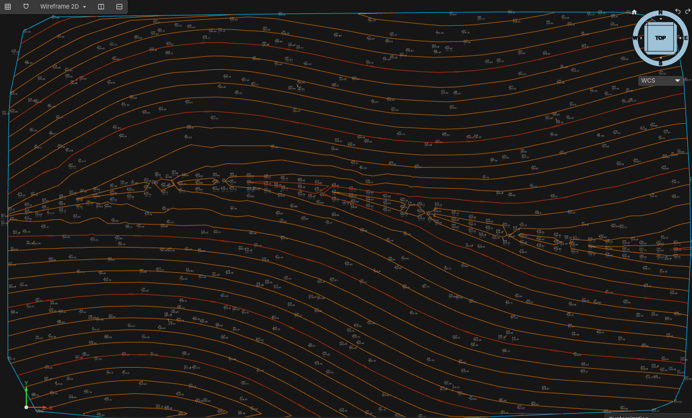
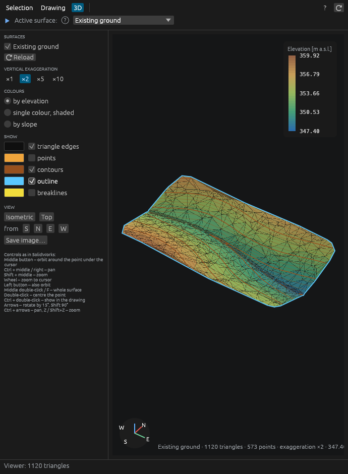
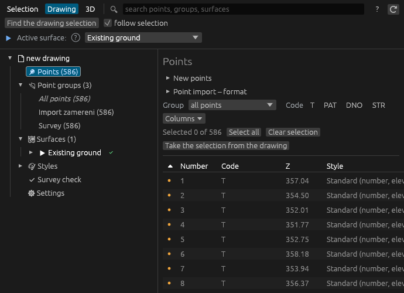

# Terén

**Survey points and terrain surfaces for Open CAD Studio.**
Import a survey, get a TIN surface with contours in a minute – and keep
everything in the drawing, editable and one Undo away.

*Česky: [README.cs.md](README.cs.md)*

## Why Terén

- **Works right away.** Point import detects the format, delimiter and
  encoding and shows a preview. A new surface recalculates itself whenever
  its points, breaklines or boundaries change.
- **You always see the state.** Up-to-date ✔ or outdated ⚠ surface, the
  active surface, where a point gets its style from, what an action will do.
- **Edit where you look.** Drag a point in the drawing, type into the point
  table, use the *Terén point* panel in the dock or the cursor menu.
- **Nothing breaks by accident.** Every action is a single Undo step. The
  surface can't be picked by a stray click.
- **Made for Czech surveys.** S-JTSK coordinates, PYXZD files from
  surveyors, Windows-1250 encoding. Interface in Czech or English.

## Start in four steps

1. Install *Terén* from the **Plugin Manager** in Open CAD Studio.
2. **Terén** tab › **Import points** › pick your survey file › check the
   preview › Import.
3. **New surface** › **Existing ground (from points)** – triangles, contours
   and labels appear.
4. Open the **Prospector** to see points, groups, surfaces and styles.

Just looking? Open the sample drawing `ukazka/teren-sample.dwg` – a small
forest survey with a finished surface.

## What it does

| Area | What you get |
|---|---|
| **Points** | Import from text and CSV in any column order, from the clipboard, Excel, LandXML, Trimble JobXML, Leica GSI and from points drawn in the drawing; preview with checks of errors, S-JTSK and duplicates. Manual points, points on a surface, survey check of suspicious elevations, export back to text. |
| **Point groups** | Rules in plain words (“code is T, PAT”, “number 1-50”, “from file …”), exclusions, points added by hand, live preview. |
| **Point styles** | Marker (cross, circle, tree, manhole, hydrant… or your own block), label layout, decimals; by code, by group or per point. Labels move aside when they overlap. |
| **Surfaces** | Delaunay TIN from point groups and drawing objects, breaklines, boundaries and holes, max. edge length. |
| **Triangle edits** | Swap, add or delete an edge, delete a triangle, add or remove a point – kept with the surface, visible at once. |
| **Display** | Minor and major contours with labels, triangles, outline, slope arrows; surface styles. |
| **3D viewer** | Colours by elevation or slope, vertical exaggeration, contours and breaklines, save as image. |
| **Prospector** | One window for the selection, the tree of everything in the drawing, settings, help and a new-surface wizard. |
| **Export** | Surface to LandXML 1.2 or DXF 3D faces; points to text files. |

Everything is stored in the drawing (DWG/DXF) – no side files, no database.

## Installation

Each Terén release is built for one Open CAD Studio release (the host checks
that both sides use the same drawing data format):

| Open CAD Studio | Terén |
|---|---|
| 2026.45 | 1.0.2 – 1.0.5 |
| 2026.44 | 1.0.0 – 1.0.1 |

- **Plugin Manager** in Open CAD Studio: find *Terén* and click Install.
- **Manually (Windows):** download `Teren-windows.zip` from
  [Releases](https://github.com/pabloxbezx/teren-ocs-plugin/releases),
  extract it and run `nainstalovat.bat`.
- **From source:** `cargo build --release -p teren_plugin` (any stable
  Rust), then copy the library and `plugin/plugin.toml` to
  `%APPDATA%\OpenCADStudio\plugins\cz.fluvio.teren`.

Language: Prospector › Settings › Jazyk / Language (automatic, Czech,
English), applied after a restart.

## Help and feedback

- **Manual** (PDF): [English](manual/Teren-manual-en.pdf) ·
  [česky](manual/Teren-manual-cs.pdf); also attached to every release.
- **In the app:** Terén tab › Help, or F1 in the Prospector.
- **What's new:** [Releases](https://github.com/pabloxbezx/teren-ocs-plugin/releases)
  and the change log in [README.cs.md](README.cs.md).
- **Found a bug or missing something?**
  [Open an issue](https://github.com/pabloxbezx/teren-ocs-plugin/issues) –
  a short description and, if possible, a small made-up survey file help most.

## For developers

- `src/` – the `teren` library: point import, TIN, breaklines, contours,
  groups, LandXML/DXF writers (also a small command-line tool that writes DXF).
- `plugin/` – the Open CAD Studio plugin (ribbon, commands, Prospector in egui).
- `preklady/en.txt` – translations, one line per text: Czech, tab, English.
  Other languages can be added the same way.
- `manual/` – manual sources (HTML) and PDFs.

## License

GPL-3.0-only.
